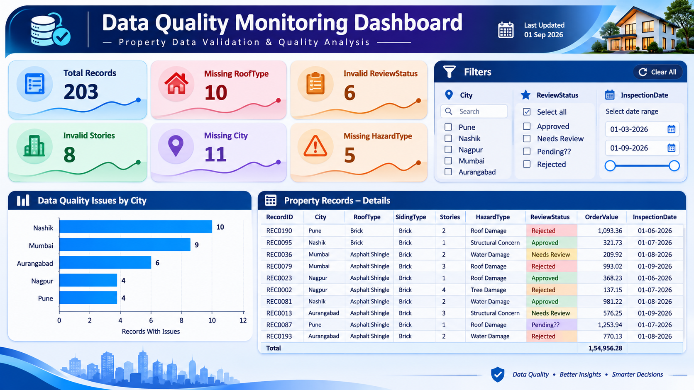

# Data Quality Monitoring & Validation Dashboard

**Tools:** SQL Server · SSMS · Microsoft Excel · Power BI · DAX

## Project Overview

This portfolio project demonstrates how SQL, Excel, and Power BI can be used to identify, validate, analyze, and monitor data-quality issues in a synthetic residential property dataset.

The workflow includes inspecting the source CSV, running SQL validation queries, comparing findings with Excel, and presenting key results in an interactive Power BI dashboard.

> **Dataset note:** This project uses synthetic practice data. It does not represent production or customer data.

## Business Problem

Incomplete or inconsistent property records can reduce confidence in reporting and downstream processes. This project applies defined validation rules to identify potential issues and make them easier to investigate.

## Objectives

- Detect missing values in required property fields.
- Identify invalid property attributes and review statuses.
- Find negative or missing order values.
- Detect duplicate record identifiers.
- Compare validation results between Excel and SQL Server.
- Present quality metrics and record-level details in Power BI.

## Tools and Technologies

| Tool | Purpose |
|---|---|
| Microsoft Excel | Initial data inspection and validation cross-checks |
| SQL Server Management Studio (SSMS) | Execute SQL validation queries |
| SQL | Missing-value checks, range checks, allowed-value checks, and duplicate detection |
| Power BI Desktop | Interactive dashboard and visualizations |
| DAX | KPI calculations and issue-count measures |
| GitHub | Project documentation and version control |

## Dataset

The sample dataset contains **203 records** and 11 columns:

`RecordID`, `InspectionDate`, `PropertyType`, `City`, `RoofType`, `SidingType`, `Stories`, `HazardType`, `ReviewStatus`, `ReviewerID`, and `OrderValue`.

## Data Quality Rules

The project checks the following:

1. **Missing City** — null, empty, or whitespace-only values.
2. **Missing RoofType** — null, empty, or whitespace-only values.
3. **Missing SidingType** — null, empty, or whitespace-only values.
4. **Missing HazardType** — null, empty, or whitespace-only values.
5. **Invalid Stories** — missing values or values outside the project rule of 1–5.
6. **Invalid ReviewStatus** — values outside `Approved`, `Needs Review`, and `Rejected`.
7. **Negative or missing OrderValue** — negative or null values.
8. **Duplicate RecordID** — identifiers appearing more than once.

See [`docs/data-quality-rules.md`](docs/data-quality-rules.md) for detailed definitions, SQL examples, and recommended actions.

## Validation Results

The current SQL validation run identified the following findings:

| Validation check | Records / IDs identified |
|---|---:|
| Total records | 203 |
| Missing City | 11 |
| Missing RoofType | 10 |
| Missing SidingType | 0 |
| Missing HazardType | 5 |
| Invalid Stories | 8 |
| Invalid ReviewStatus | 6 |
| Negative or missing OrderValue | 6 |
| Distinct duplicated RecordIDs | 3 |

The duplicated IDs identified were `REC0011`, `REC0036`, and `REC0071`, each appearing twice.

**How to interpret the counts:** These are validation findings, not necessarily unique affected records. A record may fail more than one rule, so the counts should not be added together to calculate a unique total. The negative-or-missing OrderValue check combines two conditions; separate counts would be needed to distinguish them.

## Power BI Dashboard

The report includes:

- Six KPI cards for total records and selected data-quality checks.
- A horizontal bar chart for data-quality issues by city.
- Interactive slicers for City, ReviewStatus, and InspectionDate.
- A property-record detail table for investigation.
- DAX measures for selected missing-value and invalid-value checks.
- Formatting to make potential data-quality exceptions easier to identify.

Add your final dashboard screenshot to `screenshots/dashboard-overview.png`, then uncomment or update this image reference:

<!--  -->

## Project Workflow

1. Inspect the CSV dataset in Excel.
2. Import the CSV into SQL Server.
3. Run SQL data-quality validation queries.
4. Compare SQL findings with Excel and investigate discrepancies.
5. Load the dataset into Power BI.
6. Create DAX measures and KPI cards.
7. Build the city bar chart and interactive slicers.
8. Add a record-level detail table.
9. Document the validation rules and results.
10. Publish the project files to GitHub.

## Repository Structure

```text
data-quality-monitoring-dashboard/
├── README.md
├── data/
│   └── README.md
├── sql/
│   ├── 01_data_quality_checks.sql
│   └── 02_duplicate_record_check.sql
├── powerbi/
│   └── Data_Quality_Monitoring_Dashboard.pbix
├── screenshots/
│   └── dashboard-overview.png
└── docs/
    └── data-quality-rules.md
```

This is a suggested structure. Include only files that you have created and verified. Do not commit installers, temporary files, credentials, or confidential data.

## How to Run the Project

1. Obtain the permitted synthetic CSV dataset.
2. Import it into SQL Server using SSMS.
3. Run the SQL scripts in the `sql/` folder.
4. Open the `.pbix` file in Power BI Desktop.
5. If prompted, update the data-source path to the local CSV file.
6. Refresh the report and explore the KPI cards, chart, slicers, and detail table.

If you cannot share the CSV, provide instructions for recreating or obtaining the synthetic dataset instead of publishing a restricted file.

## Key Learnings

- Writing SQL queries to identify missing, invalid, and duplicate data.
- Cross-checking data-quality findings between Excel and SQL.
- Creating DAX measures for data-quality KPIs.
- Building an interactive Power BI report.
- Documenting validation rules, findings, and limitations.

## Future Improvements

- Separate negative OrderValue records from missing values.
- Add checks for missing RecordID, ReviewerID, and PropertyType.
- Track data-quality trends across refreshes.
- Add a configurable validation-rule table.
- Create a data-quality score with clearly defined calculation rules.
- Automate validation summaries and exception reporting.

## Limitations

- The dataset is synthetic and intended for portfolio demonstration.
- Results depend on the dataset and the validation rules defined for this project.
- A populated field is not proof of real-world accuracy.
- The Stories range of 1–5 is a project-specific practice rule, not a universal property standard.
- Proposed additional checks should be run before reporting their results.

## Disclaimer

This is a learning and portfolio project built with synthetic data. It demonstrates data validation and dashboard development; it does not claim verified production-business performance.
